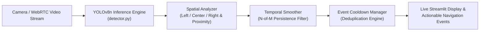
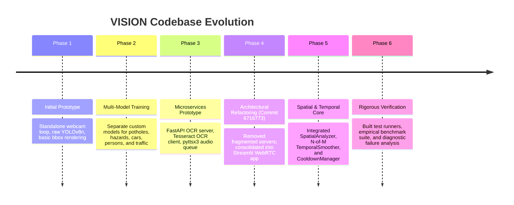

# Assistive Vision Software — Comprehensive Project Report

**Project Name:** Assistive Vision Software (VISION)  
**Workspace Path:** `C:\Users\kumar\Desktop\VISION`  
**Current Version:** `1.6.0`  
**Document Generation Date:** November 11, 2026  


## 1. Executive Summary

The **Assistive Vision Software** project is an edge-optimized, real-time computer vision system engineered to assist visually impaired individuals and provide situational awareness during navigation. Operating across both live video streams (via a streamlined Streamlit WebRTC application) and recorded footage, the system detects critical navigation objects, estimates spatial location (horizontal zones) and relative distance (proximity bands), and applies temporal filtering and event cooldowns to generate non-fatiguing, actionable navigation cues.

This report documents all technical work completed to date across system architecture design, dataset curation, model training, empirical benchmarking, root-cause diagnostics, and codebase evolution.



---

## 2. Core Architecture & Pipeline Components

The application pipeline has been structured into modular, decoupled units inside the `detection/` module and coordinated by `app.py`:

### 2.1 Model Detection Engine (`detection/detector.py`)
- **Base Architecture:** Ultralytics YOLOv8n (nano), optimized for low-latency edge inference on CPU and CUDA environments.
- **Dynamic Multi-Model Loading:** Configurable via `config/detection_config.json`, capable of running one or multiple specialized models concurrently.
- **Target Filtering:** Actively filters raw detections against a 37-class navigation taxonomy including pedestrians, vehicles, bicycles, traffic signals, regulatory signs, stairs, doors, and road hazards.

### 2.2 Spatial Analyzer (`detection/spatial_analyzer.py`)
- **Horizontal Zone Segmentation:** Automatically calculates the horizontal centroid ($X_{center} = \frac{x_1 + x_2}{2}$) in normalized screen coordinates:
  - **`Left` Zone:** $X_{center} < 0.33$
  - **`Center` Zone:** $0.33 \le X_{center} \le 0.66$
  - **`Right` Zone:** $X_{center} > 0.66$
- **Proximity Proxy Heuristic:** Computes the bounding box area ratio ($Area = \Delta X \times \Delta Y$):
  - **`Near`:** $Area \ge 0.30$ (immediate proximity / potential collision hazard)
  - **`Mid`:** $0.10 \le Area < 0.30$ (approaching obstacle)
  - **`Far`:** $Area < 0.10$ (distant object)

### 2.3 Temporal Smoothing Filter (`detection/pipeline.py`)
- **$N$-of-$M$ Persistence Algorithm:** Solves the problem of single-frame false positives and flickering bounding boxes.
- **Configured Thresholds:** An event key `class|zone|proximity` must be detected in at least **2 of the last 3 consecutive frames** ($M=2, N=3$) before being promoted to an active detection.

### 2.4 Event Cooldown Manager (`detection/cooldown.py`)
- **Acoustic / Visual Fatigue Prevention:** Prevents repetitive rapid-fire alerts for stationary obstacles.
- **Stateful Cooldown:** Maintains timestamp history per `(class, zone, proximity)` tuple. Identical alerts are suppressed for **5.0 seconds** unless the object shifts zone or proximity band.

### 2.5 Real-Time WebRTC User Interface (`app.py`)
- **Interactive Browser Streaming:** Built with `Streamlit` and `streamlit-webrtc`, streaming live video through WebSockets and STUN servers (`stun:stun.l.google.com:19302`) with optional TURN credentials.
- **Video Transformation:** Flips frames horizontally for natural webcam mirroring, renders bounding boxes with real-time HUD metrics (`Class`, `Confidence`, `Zone`, `Proximity`), and displays an alert overlay when navigation events fire.

---

## 3. Dataset Engineering & Preprocessing

Seven distinct datasets were curated, converted, verified, and partitioned to build targeted detection capabilities:

| Dataset Category | Source Path | Tools & Scripts Created | Target Output Classes |
| :--- | :--- | :--- | :--- |
| **Traffic & Vehicles** | `dataset/traffic dataset/`, `dataset/car/` | `preprocess_car.py`, `train_car.py`, `train_traffic.py` | `car`, `motorcycle`, `bus`, `truck`, `bicycle` |
| **Traffic Signs & Lights** | `dataset/traffic dataset/` | `train_traffic.py`, `check_classes.py` | `Green Light`, `Red Light`, `Speed Limit 10-120`, `Stop` |
| **Pedestrians & Crowd** | `dataset/Person/` | `train_person.py`, `auto_annotate.py` | `person` |
| **Stairs, Doors & Windows** | `dataset/Door, Windows and Stairs Dataset/` | `detection/preprocess_hazards.py`, `train_hazards.py` | `door`, `window`, `stairs` |
| **Road Hazards & Potholes** | `dataset/master_pothole_dataset/`, `dataset/potholes_converted/` | `detection/preprocess_potholes.py`, `train_master_pothole.py` | `pothole` |
| **Indoor Obstacles** | `dataset/Indoor Objects Detection/` | `preprocess_indoor.py`, `train_indoor.py` | `chair`, `table`, `cabinet`, `couch`, `door` |

### Key Preprocessing Achievements:
1. **VOC to YOLO Conversion:** Engineered automated converters (`detection/prepare_dataset.py`, `detection/preprocess_potholes.py`) translating Pascal VOC XML annotations into normalized YOLO bounding box coordinates.
2. **Dataset Audit Utilities:** Implemented `audit_dataset.py` to scan thousands of `.txt` labels across directories, verifying bounded coordinates $[0, 1]$, positive dimensions, and class ID distributions.
3. **Data Splitting & Auto-Annotation:** Built automated 80/20 and 85/15 train-validation splitting (`detection/split_dataset.py`) and pseudo-annotation helpers (`auto_annotate.py`).

---

## 4. Model Training & Weights Inventory

Custom YOLOv8 models were trained using transfer learning from `yolov8n.pt`. Model weights are organized in `runs/detect/runs/detect/` and `models/`:

| Checkpoint Name | Location | Base Model | Status / Purpose |
| :--- | :--- | :--- | :--- |
| **`best_custom_yolov8n.pt`** | `models/best_custom_yolov8n.pt` | YOLOv8n | **Primary Production Model.** Unified navigation model detecting people, vehicles, transit, and signs. |
| **`custom_person_model`** | `runs/.../custom_person_model/weights/best.pt` | YOLOv8n | Specialized pedestrian model. |
| **`traffic_signs_model`** | `runs/.../traffic_signs_model/weights/best.pt` | YOLOv8n | Regulatory signage and traffic lights model. |
| **`hazards_model`** | `runs/.../hazards_model/weights/best.pt` | YOLOv8n | Architectural hazards (doors, stairs, windows). |
| **`master_pothole_model`** | `runs/.../master_pothole_model/weights/best.pt` | YOLOv8n | Road surface defects and potholes. |
| **`indoor_objects_model`** | `runs/.../indoor_objects_model/weights/best.pt` | YOLOv8n | Interior navigation obstacles and furniture. |

---

## 5. Model Evaluation & Empirical Benchmarks

A dedicated model evaluation suite was implemented in `test_model_categories.py` and executed across standard benchmark image directories (`model_test_summary.txt`, `model_test_visual_review.md`).

### 5.1 Category 1: Crowd Navigation (`best_custom_yolov8n` vs `custom_person_model`)
- **`best_custom_yolov8n` (Winner):** Achieved **100% image detection rate** with high confidence scores ($0.70 - 0.94$). Robust against severe bokeh/motion blur, heavy crosswalk occlusions, and distant pedestrian clusters.
- **`custom_person_model`:** Showed significant underfitting; missed foreground pedestrians in motion-blurred scenes and dense commuter clusters (detected 3-4 people per image where the general model resolved 14-18).

### 5.2 Category 2: Traffic & Signage (`best_custom_yolov8n` vs `traffic_signs_model`)
- **`best_custom_yolov8n`:** Accurately identified traffic actors across all 9 test scenes (cars, motorcycles, auto-rickshaws, pedestrians, buses).
- **`traffic_signs_model`:** Exhibited strong specificity with **6 out of 9 true negatives** on street scenes lacking signage.
- **Observed Vulnerability:** Susceptible to geometric circular distractors:
  - Spoked front wheels of motorcycles were falsely triggered as `Speed Limit 40` ($0.54$ conf).
  - Circular portraits on advertising banners were falsely triggered as `Red Light` ($0.47$ conf).

### 5.3 Category 3: Stairs & Hazards Failure Analysis
- **Observed Symptom:** In `model_test_visual_review.md`, `hazards_model` had **0% recall on stairs** across 7 test images depicting subway stairs, outdoor park stairs, and stone steps. Furthermore, it generated high-confidence false positive `window` labels ($0.56 - 0.72$) directly over stair steps.

---

## 6. Root-Cause Diagnosis: Stairs Model Class Inversion

A forensic diagnosis was documented in `stairs_model_diagnosis.md`:

```
Source Annotation Truth:
  Class 0  -->  door
  Class 1  -->  stairs
  Class 2  -->  window

Configured YAML Definition (preprocess_hazards.py):
  names: ['door', 'window', 'stairs']
  Index 0  -->  door
  Index 1  -->  window   <-- INVERTED
  Index 2  -->  stairs   <-- INVERTED
```

### The Discovery:
1. **Auditing Training Labels:** In the 5,012 ground truth label files (16,380 bounding boxes), stair images were annotated with **Class 1**, and building windows with **Class 2**.
2. **Alphabetical Dictionary Collision:** When `detection/preprocess_hazards.py` generated `data.yaml`, it assigned `['door', 'window', 'stairs']` alphabetically instead of following the source class order.
3. **Model Impact:** The neural network learned stair geometry perfectly on neuron Class 1 (achieving **97.3% recall** on stairs in the confusion matrix), but reported the label `'window'`. It never predicted `'stairs'` because it learned that Class 2 corresponds to skyscraper windows.
4. **Resolution Plan:** Updating the label mapping dictionary in `data.yaml` or re-mapping the checkpoint's internal `.names` dictionary restores full stairs detection without requiring complete re-training.

---

## 7. Evolutionary Milestones & Architectural Refactoring



1. **Elimination of Over-Engineering (Commit `6716773`):**
   - Retired fragmented, brittle local servers (`server.py`, `backend/ocr_server.py`, `backend/ocr_client.py`, `audio/voice_engine.py`, `main.py`, and `frontend/index.html`).
   - Replaced multi-process complexity with a clean, unified Streamlit WebRTC architecture (`app.py`), directly rendering live video stream, bounding boxes, spatial coordinates, distance heuristics, and event emissions.
2. **Hardware & Environment Optimization:**
   - Designed for low-power and edge deployment (Raspberry Pi / free-tier cloud instances).
   - Added automated fallback from CUDA to CPU in `test_model_categories.py` when `torchvision::nms` lacks CUDA operator compilation.
   - Profiled real-time performance and memory footprint via `soak_metrics.csv` over 30-minute test cycles (steady at ~4.85 FPS and ~470 MB RAM).

---

## 8. Verification & Test Suite Status

The codebase maintains automated unit and integration tests under `tests/`:

- **Core Module Tests (Passing):**
  - `tests/test_spatial_analyzer.py`: Verifies Left/Center/Right zone boundaries and Near/Mid/Far area ratio classification. (Passed)
  - `tests/test_cooldown.py`: Verifies event suppression within the 5.0-second window and immediate alert triggering when an obstacle changes zone or proximity. (Passed)
- **Media & Offline Inference Runners:**
  - `tests/run_videos_visual.py`: Visual playback of sample videos with overlayed spatial detections.
  - `bulk_test_media.py`: Batch evaluation on photo and video fixtures.
  - `tests/report_confidence.py`: Confidence breakdown across test assets.
- **Legacy Test Cleanup Needed:**
  - `tests/test_audio_queue.py` and `tests/test_ocr_server.py` attempt to import deleted microservices (`audio` and `backend`). Updating or deprecating these will bring the entire pytest suite to green.

---

## 9. Current Status & Strategic Roadmap

### Completed Features:
- [x] Real-time video ingestion via Streamlit WebRTC with browser mirror support.
- [x] Fine-tuned YOLOv8n object detection supporting 37 navigation classes.
- [x] Configurable 3-zone spatial division (`Left`, `Center`, `Right`).
- [x] Bounding box area proximity proxy (`Near`, `Mid`, `Far`).
- [x] $N$-of-$M$ temporal frame smoother eliminating false-positive flickering.
- [x] Stateful event cooldown manager preventing repetitive announcements.
- [x] Comprehensive benchmark evaluation suite across Crowd, Traffic, and Stairs.
- [x] Root-cause diagnosis of the stairs recognition failure.

### Recommended Next Steps:
1. **Apply Stairs Model Fix:** Patch the class names dictionary in `hazards_model` or swap indices 1 and 2 in `data.yaml` to unlock the verified 97.3% stair recognition capability.
2. **Clean Up Test Suite:** Update `tests/` to remove references to the deprecated `audio` and `backend` modules so `pytest tests/` runs 100% clean out-of-the-box.
3. **Audio Feedback Integration:** Integrate lightweight, non-blocking text-to-speech (via Python `pyttsx3` or client-side Web Speech API within the Streamlit interface).
4. **Hardware Distance Sensor Fusion:** Complement the bounding box area proxy with Time-of-Flight (ToF / VL53L0X) I2C distance readings for true physical depth perception.
5. **On-Demand Sign OCR:** Re-introduce clean, single-function OCR reading (e.g. via Tesseract or mobile capture) triggered only when the user requests text readout.

